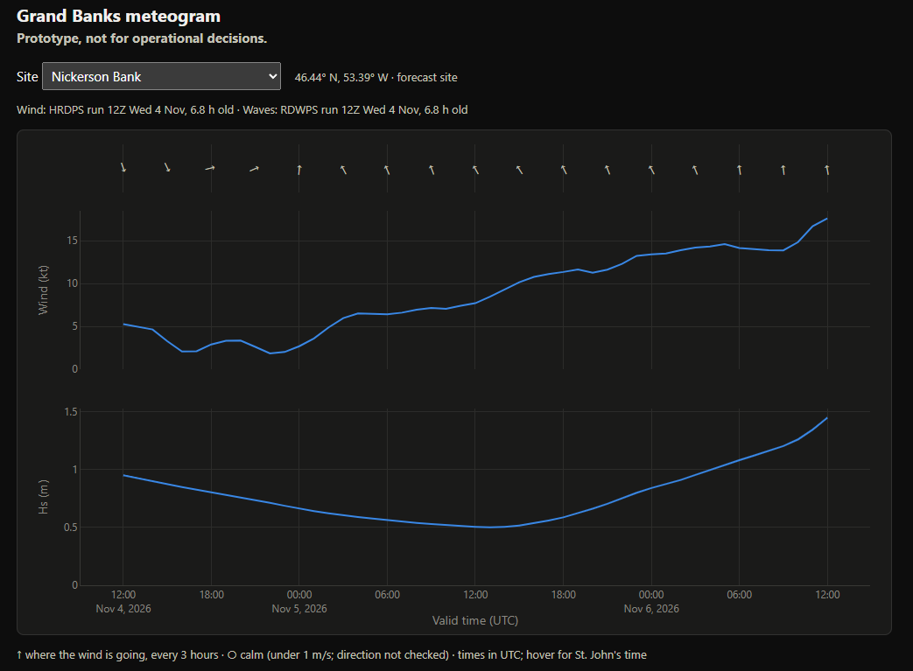
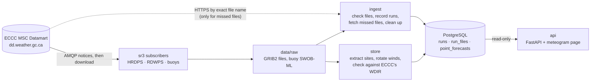

# Grand Banks Weather Window Finder

A pipeline that pulls Canada's weather forecasts for offshore Newfoundland as they're published, decodes them, and stores wind and wave forecasts at fixed offshore sites. Its goal is to answer one question for offshore operators: **when is the next workable weather window for a job, and how confident are we?**

Today it does the first part: live ingest, decoding, checks, a forecast chart, and a first comparison of forecasts with a real buoy. Automated nightly scoring, more models, and the window finder itself come next (see [What's next](#whats-next)).

> **Prototype, not a safety tool.** Built on public data for learning and as a portfolio piece. Any operational limits in it are examples, not real company limits.

**Status, Nov 15, 2026:** Phase 1 of 6 done; Phase 2a (a second model, parameter mapping, nightly verification) in progress. Running unattended on a small AWS VM (ARM, Ubuntu, Docker Compose) since Oct 28.

**How it was built:** Claude Code wrote the code. I approved each piece before it was written, checked the raw data by hand (`grib_dump`, Jupyter notebooks, the browser), and can walk you through how it works.



*Nickerson Bank, from the HRDPS and RDWPS runs of 12Z Wed Nov 4, 2026. Arrows show where the wind is going, every 3 hours; hovering shows each hour's values in UTC and St. John's time.*

## How it works



Seven Docker Compose services; all but `db` run from one image built from the [Dockerfile](Dockerfile):

| Service | Job |
|---|---|
| `sr3-hrdps`, `sr3-rdwps`, `sr3-buoys` | ECCC's [sr3](https://github.com/MetPX/sarracenia) client. Each holds an AMQP subscription and downloads matching files as ECCC announces them. |
| `ingest` | Every minute: checks each new file is a whole GRIB2 file, records it against its run, works out each run's status (receiving, late, complete, incomplete), fetches files the feed missed, and deletes raw files of old extracted runs. |
| `store` | Extracts each finished run at the sites in [config/sites.yaml](config/sites.yaml) into `point_forecasts`, one row per site, hour and variable, each with its unit. |
| `db` | PostgreSQL 17. |
| `api` | Serves `/api/sites/{site}/latest` and the meteogram page, through a read-only database connection. |

**Models:** HRDPS (High Resolution Deterministic Prediction System, 2.5 km) for 10 m wind, and RDWPS (Regional Deterministic Wave Prediction System, national 2.5 km domain) for significant wave height and peak period. Both run four times a day; we keep hours 0 to 48.

**Sites:** two forecast sites on the Grand Banks (Nickerson Bank, and WSP's 2022 buoy position) and two verification sites with live buoys: ECCC buoy 44139 at Banquereau Bank (offshore), and SmartAtlantic's buoy at the St. John's harbour approach (coastal, so its scores aren't comparable with offshore ones). No buoy on the Grand Banks itself is reporting, so offshore checks have to happen at Banquereau, 379 km southwest of Nickerson Bank.

## Data problems it handles

- **Winds on a rotated grid.** HRDPS uses a rotated latitude-longitude grid, and its u/v wind components are grid-relative (the GRIB header's component flag says so), so "u" doesn't point east. The extractor rotates each site's winds to earth-relative using the grid's local tilt, then compares the direction with ECCC's own `WDIR` field every hour. A run more than 5° off is refused, not stored. Below 1 m/s the check is skipped: direction is barely defined near calm, and rounding in the packed data grows as the wind drops.
- **Two models, two grids.** RDWPS sits on a different grid from HRDPS, so each site's grid cell is looked up per model. Reusing the wind cell on the wave grid would land 8 km off.
- **A push feed, not polling.** ECCC's usage policy requires its AMQP feed for systematic retrieval and asks users not to request directory listings. No code path lists a Datamart directory.
- **Missing files and missing runs.** ECCC caps a queue at 10,000 notices, and one HRDPS run announces about 20,600 files (we filter on our side), so a few hours offline loses notices. The ingest knows every file name a complete run should have, so a late run's missing files are fetched over HTTPS by exact name, with backoff. A live test recovered 4 deleted files. Runs that never sent a single file are noticed from the clock, not by waiting.
- **Half-finished runs.** A run extracted with gaps is extracted again once its missing files arrive. Until then, and for any refused run, the API serves the previous good run instead.
- **Disk on a small VM.** Raw files arrive at about 2.2 GB a day. Once a run is extracted and 5 days old, its GRIB files are deleted by exact name; refused runs keep theirs for debugging, and the extracted values stay. At steady state about 20 runs per model are on disk.
- **Freshness.** The API flags a run stale once it's more than 12 hours old (normally the newest is 3.5 to 9.5 hours old), and the page says so in words.

Conventions throughout: all times in UTC and timezone-aware; values stored in SI units, each with its unit, and converted to knots only on the page; wind direction is the direction the wind comes **from**. Each site takes the value at the nearest grid point, without interpolation.

## What it has measured so far

From Oct 28 18Z to Nov 4 12Z, one week. **A small sample:** treat these as first observations, not statistics.

- **28 runs per model, all complete, none refused.** This includes a 3-day unattended run at the start.
- **Run arrival,** from ECCC's publish times (median, after the run's nominal time):

  | Model | First file | Last file | Last file, range |
  |---|---|---|---|
  | HRDPS | 2 h 49 min | 3 h 16 min | 3 h 14 min to 3 h 27 min |
  | RDWPS | 3 h 24 min | 3 h 27 min | 3 h 26 min to 3 h 29 min |

  So a full run is ready about 3.5 hours after its nominal time. RDWPS starts publishing a few minutes after HRDPS's last file. ECCC documents that RDWPS is driven by HRDPS winds; that it waits for them is our inference from these times.
- **Wind direction vs ECCC's `WDIR`:** worst gap 1.10° in the 25 HRDPS runs whose logs survive, against the 5° limit. Gaps grow as the wind gets lighter.

### A first look at forecast accuracy

Each forecast hour compared with what buoy 44139 measured at that hour, grouped by lead time (hours after the run started). Bias is the average error, forecast minus buoy, with its sign; RMSE (root mean square error) is the typical size of an error.

| Compared with buoy 44139 | 0–11 h | 12–23 h | 24–35 h | 36–48 h |
|---|---|---|---|---|
| HRDPS wind vs the buoy's raw 5 m reading: bias | +0.67 | +0.64 | +0.58 | +0.47 m/s |
| HRDPS wind vs the reading adjusted to 10 m: bias / RMSE | +0.07 / 1.09 | +0.04 / 1.25 | −0.01 / 1.44 | −0.12 / 1.54 m/s |
| RDWPS wave height vs the buoy's spectral value: bias / RMSE | +0.09 / 0.21 | +0.06 / 0.22 | +0.03 / 0.23 | +0.01 / 0.22 m |
| RDWPS wave height vs the counted value (NDBC's `WVHT`): bias | +0.16 | +0.14 | +0.10 | +0.08 m |

32 runs per model (Oct 28 18Z to Nov 5 12Z) against 186 hourly buoy reports: about 1,365 forecast–buoy pairs per row. **A small sample:** nine days at one buoy cover only a handful of weather systems, and neighbouring hours are strongly linked, so these are first observations, not statistics. Computed in a one-off analysis of the saved files; automated nightly scoring is Phase 2a's next step.

What it shows so far: the choice of comparison matters as much as the model. Against the raw 5 m reading HRDPS looks 0.5–0.7 m/s too windy; adjusted to the model's 10 m, the bias is about zero. Wind errors grow with lead time, as expected. Wave height errors don't, in this sample, which is an open question.

### Found while preparing Phase 2a

- **Two wave heights in one buoy report.** Buoy 44139's SWOB-ML files carry both a spectral significant wave height (Hm0, the definition wave models compute) and one from counting individual waves (H1/3). The spectral one averaged 0.08 m higher. NOAA's NDBC copy of the same buoy reports only the counted one (it matched in 25 of 25 hours), so scoring a wave model against NDBC adds bias that isn't the model's, as the table shows.
- **Anemometer height.** The buoy's anemometer is about 5 m above the sea; model wind is at 10 m. The adjustment above uses the standard logarithmic wind profile (× 1.068, assuming neutral stability, which is a simplification). The anemometer-height field is marked missing in all 186 buoy files, so the 5 m comes from ECCC's buoy documentation.
- **Only 25 hours at NDBC.** NOAA's NDBC keeps just the last 25 hours of these ECCC buoys, rounding wind to whole m/s and direction to 10°. A cross-check against it has to run daily; it can't be filled in later.
- **A "mean period" that holds a peak period.** GFS-Wave's `PERPW` is named "primary wave mean period" in the GRIB2 tables, but NOAA's WAVEWATCH III source writes the peak period into it (checked in `ww3_grib`). By its name, it couldn't be compared with a buoy's peak period; by its contents, it can.
- **Coarse grids need their own limits.** GFS's nearest grid point to Nickerson Bank is 10.75 km away. The extractor's 2 km sanity limit, set for HRDPS's 2.5 km grid, would refuse every GFS site, so the limit has to come from each model's config.
- **A catalogue that points elsewhere.** SmartAtlantic's buoy is listed in CIOOS Atlantic's ERDDAP catalogue, but data requests there are redirected to SmartAtlantic's own server, and the catalogue's end date is stale.

## Run it yourself

Needs Docker with Compose.

```bash
cp .env.example .env          # then set POSTGRES_PASSWORD
docker compose up -d --build  # the whole pipeline, as on the VM
```

The meteogram is at http://localhost:8000, and the API's interactive docs at http://localhost:8000/docs. Forecasts appear once a run has arrived and been extracted; runs are complete about 3.5 hours after their nominal time (00Z, 06Z, 12Z, 18Z). Ports are bound to localhost only; to reach a server's copy, use an SSH tunnel (`ssh -N -L 8001:localhost:8000 <server>`, then http://localhost:8001).

**Tests:** 147, with `pytest` from the repo root, in a conda-forge environment with the packages in [environment.yml](environment.yml) plus `pytest` and `httpx2`. Database tests skip unless the `db` container is up. Tests that read real GRIB files skip when `data/raw/` is empty, because downloaded data isn't in git. On a development machine with real files, start only `docker compose up -d db api`: the full stack would start the cleanup, which could delete files those tests use.

## What's next

**Phase 2a, in progress:**
- Done: the two verification sites, and a hand check of NOAA's GFS and GFS-Wave files (byte-range downloads from AWS, wind component flags, grid distances, field definitions).
- Next: GFS and GFS-Wave through one config table (`param_map.yaml`) covering all four models, with GFS history backfilled from AWS.
- Parse the buoy files, with NDBC as a daily cross-check, and score every model at both buoys every night.
- First contact with AWIPS: Unidata's public EDEX server, through CAVE and python-awips.

**Later:**
- 2b: a Java decoder checked against the Python output, ECMWF, a common grid, and a hindcast at WSP's 2022 Grand Banks buoy.
- 3: ensembles and the weather-window engine.
- 4: a comparison with ECMWF's AI model, AIFS.
- 5: a decision dashboard.
- 6: Terraform, a runbook, and an AWIPS configuration for ECCC's models.

**Limits today:**
- Verification so far is the one-off analysis above, at one buoy; it isn't automated yet.
- One deterministic run per model, with no ensemble spread, so there's no "how confident" yet.
- No live buoy on the Grand Banks itself.
- The project doesn't use AWIPS yet. The rotated-grid wind problem it handles is one any system showing ECCC's models has to solve, AWIPS included.

## Repository map

```
api/          FastAPI app and the meteogram page (api/static/meteogram.html)
config/       sites.yaml (where), models.yaml (expected files, deadlines, retention)
db/init/      table definitions, applied when Postgres is first created
ingest/       sr3 configs, ingest scan, run status, fallback, extraction, store, cleanup
notebooks/    hand checks: first look at an HRDPS file, wind rotation vs WDIR
tests/        pytest suite
docs/         research notes and the meteogram screenshot
```

## Data and licence

Forecast and buoy data: Environment and Climate Change Canada, MSC Datamart, under the [Open Government Licence – Canada](https://open.canada.ca/en/open-government-licence-canada). Raw data isn't stored in this repository.
